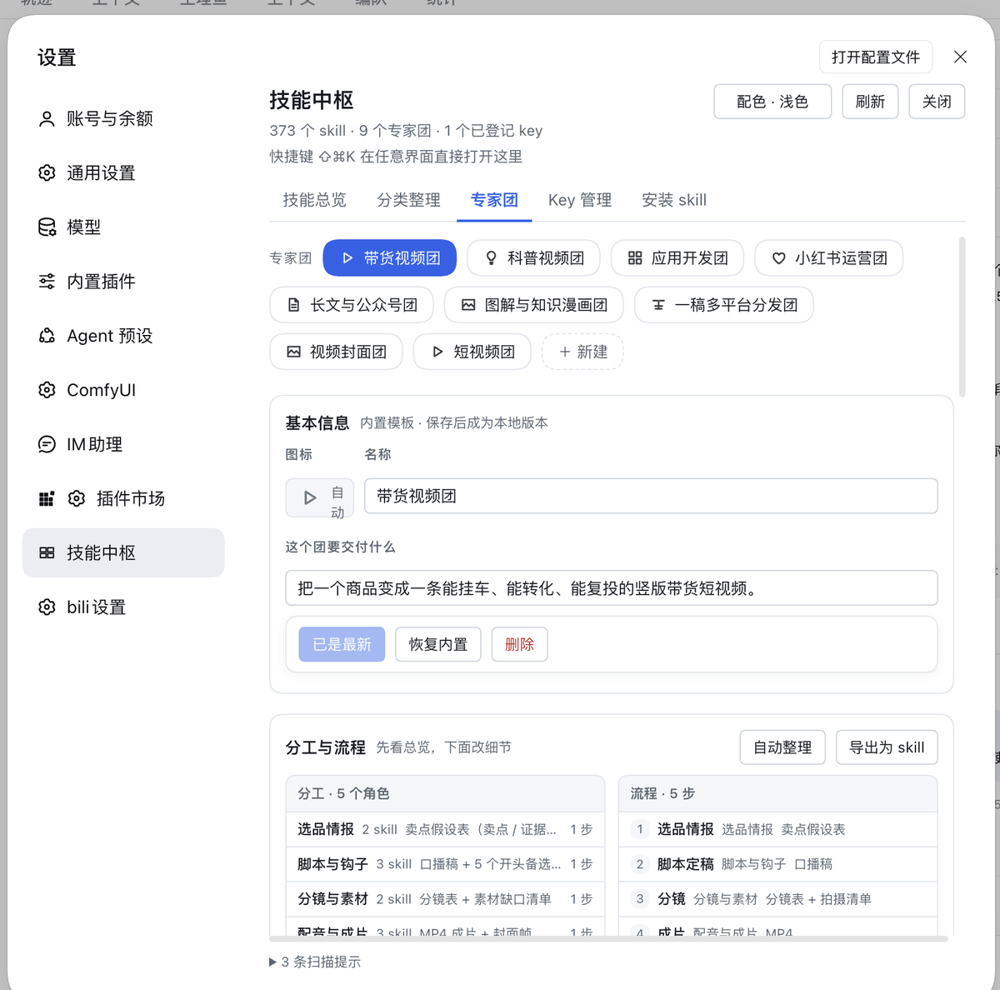
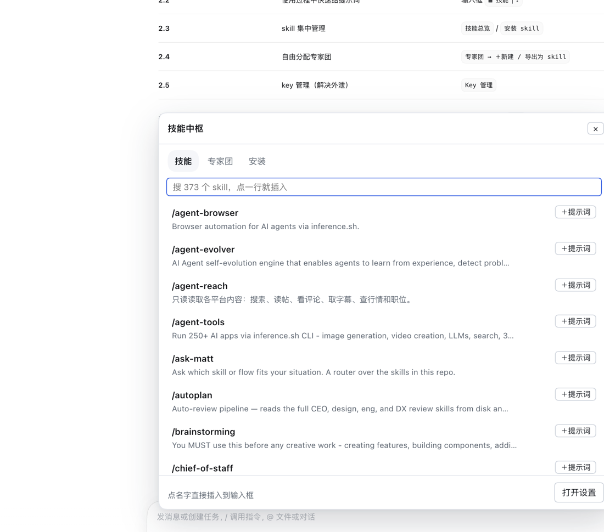

# 技能中枢 · Skill Hub

**它不自带任何 skill。** skill 是你自己装的；这个插件只做四件事：把它们**列清楚、分好类、编成队、装得规矩**。它不碰 key —— 需要 key 的 skill 自己管。

`v0.4.3` · 103 条测试 · 零依赖 · MIT · DSH ≥ 0.2.2


---

## 五个痛点，五个解

### 1. 装了几百个 skill，用时一个都想不起来

搜也不一定搜得到：名字跟用途没关系，描述又是英文。

→ **自动分 12 类**（内容与视频 / 写作 / 设计 / 开发 / 协作 …），可手改；一条命令或一个搜索框就能列出本机全部 skill，并标出「只在 Claude 有」「被 DSH 遮蔽」这类坑。

### 2. 知道要用哪几个 skill，但不知道谁先谁后

「选品 → 脚本 → 分镜 → 配音 → 发布」每一步该装载哪个 skill、交付什么、卡在哪，全靠脑子记。

→ **专家团**把一条链路拆成**角色**（每个角色绑几个 skill）和**阶段**（第几步、由谁、产出什么），再加几条铁律。内置 9 个团（带货视频 / 科普 / 应用开发 / 小红书运营 …），也能自己建、导出成 skill 给别的 agent 用。



### 3. 每写一句都在重打 skill 名和提示词

`/baoyu-xhs-images` 这种名字打三遍就烦；想把「用哪个 skill、做什么、别做什么」说清，提示词比任务还长。

→ 输入框旁边的 `▦ 技能`：**点一行就插进输入框**（`/<name> ` 或整句提示词）；专家团更狠，**一键插整本任务书**（全部角色 + 每步装载顺序 + 流程 + 自检 + 铁律）。



### 4. 每个 skill 到处藏 key，谁都能翻出来 —— 这件事交给 skill 自己管

第三方的 key（微信读书、高德、各家 AI）不该由插件统一保管，也不该写进 skill 正文。**这个插件完全不碰 key**：它不存、不读、不生成命令。

正确做法是**谁用谁负责**：哪个 skill 需要 key，就在那个 skill 自己的目录里说明「要哪个环境变量、去哪儿申请、放进哪个文件」，密钥只留在你自己的机器上。比如微信读书的 key 就放在 `~/.agents/skills/weread-skills/.env`（权限 600），skill 用之前 `source` 一下即可。

这样做的好处很直接：插件被卸载、被审计、被别的 agent 读取，都不会顺手带走你的密钥。

### 5. 装 skill 全靠复制粘贴，装完还不知道装到哪了

同一个仓库往 20 多个 agent 目录各放一份；同名覆盖后旧版本找不回来。

→ **规范安装**：真实目录只落 `~/.agents/skills/<name>`；同名多副本自动合并；同名**只能替换不能合并**，旧版进 `_trash/<日期>/` 可回退；每次安装写一行日志。


---

## 一分钟上手

```bash
# 插件市场：设置 → 插件市场 → 发现 → 添加索引
https://raw.githubusercontent.com/TongjieYang/dsh-skill-hub/main/market/index.json
```

打开：任意界面 `⇧⌘K`（或 设置 → 技能中枢，或输入框左侧 `▦ 技能`）。

## 先初始化，再谈配方

初始化 = 让 agent 把库里每个 skill 认一遍：**叫什么、解决什么问题、什么场景该用、和谁搭配更好**。结果存成本地档案（`~/.agents/skill-hub/profiles.json`），专家团的分工和输入框的提示词都读它。

- 技能总览顶部有初始化卡片：点 `生成初始化任务书`（自动复制）→ 粘到对话框发给 agent → 它分析完会调 `skill_hub_profile` 自动写回。
- 也可以让 agent 把结果贴回来，粘进框里点 `导入画像 JSON`。
- 卡片上一直显示进度 `已画像 x/373`；全部完成会变成「初始化完成」。

**没初始化也能用**，只是专家团里的「和谁搭配」只能靠描述猜；初始化之后，建议是按你自己的库算出来的。

## 一键更新

安装页顶部有 `检查更新`：只检查**这个插件装过**的 skill（`install.log` 里记着来源仓库），逐个比内容指纹，**变了才替换**；`全部更新` 一次做完，旧版照例进 `_trash/` 可回退。你自己手动丢进目录的 skill 不会被碰。

## 其余两个页签

| 页签 | 干什么 |
|---|---|
| **技能总览** | 全部 skill + 分类筛选 + 技能库体检（主库软链 / DSH 遮蔽 / 端侧实体副本 / name 不一致） |
| **分类整理** | 12 类看板，默认折叠；列头下拉可手改归类，手改优先 |


## 边界（先说清楚，避免误会）

- **不自带 skill**：仓库里一个 skill 都没有，装完看到的是你自己的库。
- **不接管 skill 内容更新**：不修改、不覆盖你已有的 skill 正文；「更新」指的是重新装一个新版本（旧版进 `_trash/`）。
- **只读扫描**：读 `~/.dsh/skills`、`~/.agents/skills`、`~/.claude/skills`，不改不删。
- **不写 dotfile**：入匙命令给你，执行权在你。
- **HTTP 路由**：只监听 loopback，并用 DSH 的连接信任校验 + `sec-fetch-site` 双重拦截，浏览器里的网页无法调用。

## 常见问题

**装 `yt-dlp/yt-dlp` 说「不是 skill 仓库」？**
对，它不是。命令行工具先 `brew install yt-dlp`，再按 [docs/DETAIL.md](docs/DETAIL.md) 里的模板包一层薄 `SKILL.md`。

**改了代码要重启吗？**
`client.js` 刷窗口（`⌘R`）；`index.js` / `lib/*` 必须重启 DSH。

**`~/.dsh/skills` 要放东西吗？**
不要。它 rank 400，会遮蔽主库同名条目。

## 演示


## 开发

```bash
node --test "tests/*.test.mjs"
```

宿主 `index.js` + 浏览器 `client.js`，零依赖、无构建。改动记录见 [docs/DETAIL.md](docs/DETAIL.md)。

## License

MIT
