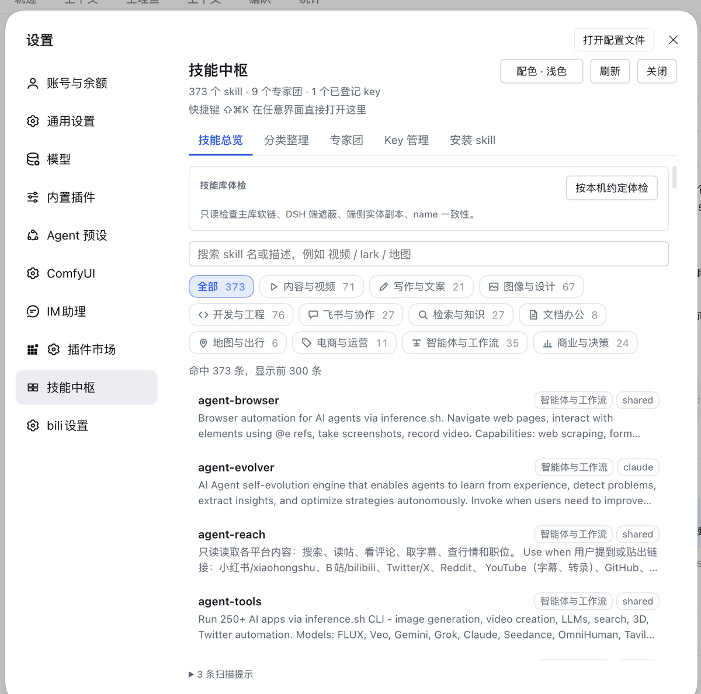
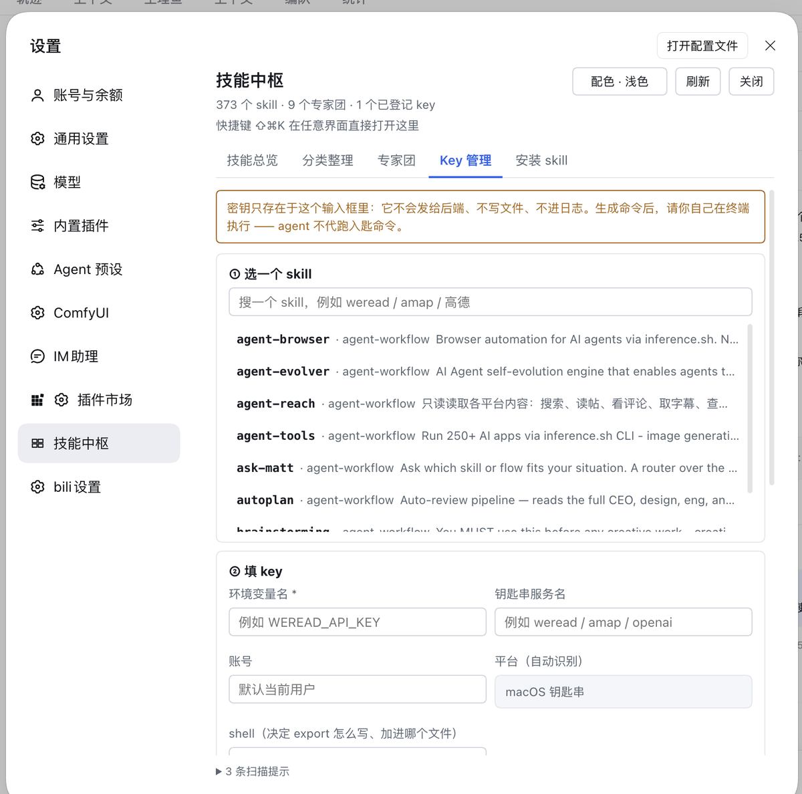

# 技能中枢 · Skill Hub

一个 DSH 插件：把散在各处的 skill 收拢成一张可搜索、可分类、可组合的清单，把常用的工作流配成「专家团」，把第三方 key 收进系统钥匙串。

`v0.3.10` · 测试 119/119 · 零依赖（纯 ESM，无构建） · MIT · DSH ≥ 0.2.2



---

## 一分钟上手

**装**（三选一）

```bash
# 1) DSH 插件市场：设置 → 插件市场 → 发现 → 添加索引
https://raw.githubusercontent.com/TongjieYang/dsh-skill-hub/main/market/index.json

# 2) 命令行
dsh plugin add git+https://github.com/TongjieYang/dsh-skill-hub.git

# 3) 本地目录
plugin_manager({ action: "install_bundle", target: "~/ai-project-hub/dsh-skill-hub" })
```

**打开**：任意界面按 `⇧⌘K`；或 设置 → 技能中枢；或点输入框左侧的 `▦ 技能`。

---

## 它解决的五个痛点

| # | 痛点 | 现在的做法 | 在哪 |
|---|---|---|---|
| **2.1** | 分类混乱，不知道该在哪个环节用哪个 skill | 12 类自动归类（可手改）；专家团把链路拆成**角色**（各自绑 skill）与**阶段**（谁第几步交付什么） | `分类整理` / `专家团` |
| **2.2** | 每写一句都在重打 skill 名和提示词 | 输入框 `▦ 技能` 搜一行点一下，直接插 `/<name> ` 或整句提示词；专家团一键插整本任务书 | 输入框左侧 |
| **2.3** | 看不见本机到底装了多少 skill | 多根扫描去重、遮蔽/容器标记、体检不合规项、安装/替换/回退 | `技能总览` / `安装 skill` |
| **2.4** | 专家团不能自由分配 | 新建团、增删角色、角色随便绑/解绑 skill、调阶段顺序、导出成独立 skill | `专家团` |
| **2.5** | key 到处漏 | 只存元数据、密钥不落盘；先选 skill 自动认变量名；生成钥匙串命令**由你自己执行** | `Key 管理` |

---

## 界面导览

### 1. 技能总览 —— 我本机到底有什么


1. 顶部 **技能库体检**：只读检查主库软链、DSH 端遮蔽、端侧实体副本、目录名与 `name` 是否一致；点 `按本机约定体检` 出结果。
2. 搜索框按名字或描述过滤；下面 12 个分类胶囊点一下就是筛选，`全部` 回到全量。
3. 每条显示 name / 描述 / 分类 / 来源端（`shared` = 主库，`claude` = 只在该端）。

### 2. 分类整理 —— 12 类看板，可手改


1. 每列是一类，列头显示数量，**默认折叠**（不把 373 条一次铺满）。
2. 点列头展开；列头右侧的下拉可以把整列改到别的类，**手改优先于自动分类**，存在 `~/.agents/skill-hub/config.json`。
3. 顶部搜索框在分类视图里也能用，匹配到的那条会自动展开所在列。

### 3. 专家团 —— 把流程配成一支队伍


1. 顶部胶囊切换团（内置 9 个：带货视频 / 科普视频 / 应用开发 / 小红书运营 / 长文与公众号 / 图解与知识漫画 / 一稿多平台分发 / 视频封面 / 短视频），`＋ 新建` 造自己的。
2. **基本信息**：图标、名字、这个团要交付什么（一句话目标）。
3. **分工与流程**：左边 5 个角色，每个角色写清「职责 + 产物 + 绑定哪些 skill」；右边 5 步流程，每步指定由哪个角色交付什么。`自动整理` 补齐空字段，`导出为 skill` 写成 `~/.agents/skills/team-<id>/SKILL.md`，Codex / WorkBuddy 也能直接用。
4. 往下还有**铁律**（会原文进任务书），例如「开头 3 秒必须出现具体数字，禁止『大家好』起手」。

> 专家团里绑定的 skill 是**名字快照**：删了 skill 会显示「⚠️ 本机没有这个 skill」，团本身不坏。

### 4. Key 管理 —— 密钥不落盘



1. 先选一个 skill，插件从它的正文里认出变量名（如 `WEREAD_API_KEY`），自动填好环境变量名与服务名。
2. 填备注，点 `生成命令`——得到的是**两类命令**：`security add-generic-password …`（推荐，隐藏输入，密钥不进 shell history）与一条带值的捷径版。
3. **命令由你自己在终端执行**，插件不写任何 dotfile、不改 `~/.zshrc`；要一直生效，自己把 `export` 那行加进对应文件（界面会按 zsh / bash / fish / PowerShell / cmd 给对语法和文件名）。
4. 已登记的 key 只显示元数据（变量名 / 服务名 / 备注），列表里永远没有密钥。

### 5. 安装 skill —— 从 GitHub 装进来


1. 填 `owner/repo` 或仓库 URL（也支持 `owner/repo/tree/main/子目录`）。
2. 点 `预览仓库里的 skill` → 列出候选（同名多副本会合并成一份）。
3. 勾选 → `装到 ~/.agents/skills`；同名已存在时**只能替换不能合并**，旧目录进 `~/.agents/_trash/<日期>/skill-hub/`，随时可回退。
4. **如果这个仓库里没有 `SKILL.md`**（比如 `yt-dlp/yt-dlp`），会明确告诉你「这不是 skill 仓库」并给正确做法，而不是报一串错——见下面 [常见问题](#常见问题)。

---

## 输入框里的入口


点输入框左下 `▦ 技能`，是一个三段控件：

- **技能**：搜 373 个 skill，点一行插 `/<name> `；点右侧 `＋提示词` 插整句（中文「用这个 skill 完成：…」/ 英文 "Use this skill to: …"）。
- **专家团**：选团 → 摊开目标 / 分工 / 流程 → `插入完整任务书` 把全部角色、每步装载的 skill 顺序、流程、三条自检、铁律一次贴进输入框。
- **安装**：右段的下载图标直达安装页签。
- 右下 `打开设置` 跳技能中枢。

---

## Agent 侧工具

| 工具 | 用途 |
|---|---|
| `skill_hub_scan` | 列本机 skill（关键词 / 类别过滤），带分类统计 |
| `skill_hub_team` | 取某个专家团的完整 SOP（可只看某一阶段） |
| `skill_hub_key_script` | 生成入匙命令模板（只含 `__SECRET__`，拿不到真实密钥）；给 `skill` 自动找变量名 |
| `skill_hub_install_skill` | 从 GitHub 装 skill 到 `~/.agents/skills`（真实目录、不用软链、同名不覆盖、多副本自动合并） |
| `skill_hub_team_export` | 把专家团导出成 `~/.agents/skills/team-<id>/SKILL.md` |
| `skill_hub_audit` | 技能库体检：主库软链、DSH 端遮蔽、端侧实体副本、name 不一致、无 description、容器目录、未分类 |

## 装 skill 的规矩

1. 真实目录只落 `~/.agents/skills/<name>`，**不建软链**；
2. 身份取 `SKILL.md` front-matter 的 `name`，不是文件夹名；
3. 同名目录已存在就跳过并报出来（`replace: true` 才替换，旧版进 `_trash/`）；
4. `git clone` 只落临时目录，装完即删；
5. 每次安装写一行 `~/.agents/skill-hub/install.log`（时间/来源/名字/落点），可回滚。

## 从 DSH 插件市场安装

本仓库自带插件索引，把下面 URL 加进 DSH「设置 → 插件市场 → 发现」即可：

```
https://raw.githubusercontent.com/TongjieYang/dsh-skill-hub/main/market/index.json
```

索引里的版本用 **Git 源 + 固定 commit**（`git+https://…git#<40 位 commit>`），装到的一定是校验过的那次提交，不是浮动的 `main`。

## 演示视频


26 秒：输入框分段控件入口 → 技能页点一行插提示词 → 专家团「插入完整任务书」。录制脚本见 [docs/demo-script.md](docs/demo-script.md)。

## 数据 / 扫描 / 边界

| 项 | 值 |
|---|---|
| 数据目录 | `~/.agents/skill-hub/`（`config.json` 存分类与自定义根、`teams/*.json` 存团、`install.log` 存安装记录；**没有 secret**） |
| 扫描根 | `~/.dsh/skills`(rank 400) → `~/.agents/skills`(500) → `~/.claude/skills`(600)；rank 小者生效，同名后来者记为「遮蔽」 |
| 不在扫描范围 | `~/.workbuddy/skills`（按需挂载的软链视图）、`~/.codex/skills`（计划重装后再接） |
| 安全边界 | 密钥不上传/不落盘/不进日志；agent 只拿得到 `__SECRET__` 模板；路由只监听 loopback，跨站写入 403 |

## 常见问题

**Q：装 `yt-dlp/yt-dlp` 报错？**
它不是 skill 仓库（里面没有 `SKILL.md`），技能中枢只能装 skill。命令行工具这样处理：

```bash
brew install yt-dlp        # 先装工具本身
```

想让 agent 会用，再按 [docs/DETAIL.md#给已有工具包一层-skill](docs/DETAIL.md) 包一层薄 SKILL.md（里面有现成模板）。

**Q：改了 `client.js` 要重启吗？** 不用，刷新窗口（`⌘R`）即可；改了 `index.js` / `lib/*` 必须重启 DSH。

**Q：`~/.dsh/skills` 要不要放东西？** 不要。它 rank 400 会遮蔽主库同名条目；DSH 原生读主库，零配置。

## 更新日志

每个版本的改动、验收证据与已知边界都在 [docs/DETAIL.md](docs/DETAIL.md)。

## 开发

```bash
node --test "tests/*.test.mjs"   # 119 条：扫描/分类/安装/入匙/路由/UI 审核
```

宿主 `index.js` + 浏览器 `client.js`，零依赖、无构建。

## License

MIT
